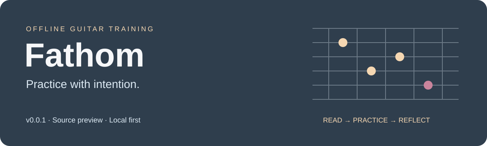

# Fathom v0.0.1 — full clean staging candidate

**Offline guitar practice, source reading and recoverable local work—with private planning prose separated from the runtime.**

> **Full content, development prerelease.** This candidate retains the functional curriculum and does not use empty lesson interfaces. Known private planning/review prose and verifier artifacts are archived separately. This repository is public and the project source is licensed under [AGPL-3.0](LICENSE). The owner confirms that the entire curriculum and exercises were generated for Fathom and are free to use. Separately identifiable third-party dependencies and assets retain their own licenses and obligations.

[User guide](docs/user-guide.md) · [Build](docs/development.md) · [Architecture](docs/architecture.md) · [Data & recovery](docs/data-and-recovery.md) · [Publication status](docs/licensing.md)

## Choose your path

| Home destination | Functions |
| --- | --- |
| **Learn** | Existing levels/exercises, source explanations, queue resume, admitted Practice and Learn-only clear queue. Exercise library opens from Learn. |
| **Free play** | Independent timer/resume, metronome, rhythm preview, reference tones and shared audio settings. |
| **User profile** ↗ | Named profile and recovery identity, setup, Progress/history, default BPM and guitar configuration. |
| **Settings** | Presentation, appearance and preview information. |
| **Quit** ↘ | Existing save/discard/cancel and original-operation release/recovery workflow. |

New Guided entry stays disabled; retained originals keep their protected resolution route. Default BPM 20–300 seeds new Learn choices without retiming retained work. Presentation changes disclosure, not admission or credit. Fathom does not automatically assess guitar performance or infer mastery from reading a source.

## Install the macOS development package

The [v0.0.1 macOS arm64 local prerelease, revision 20261104-r01](https://github.com/Noreastlabs/Fathom/releases/tag/v0.0.1-macos-arm64-local-20261104-r01) includes a ready-built `Fathom.app` in a ZIP. No compiler, CMake, Python, Git or Git LFS is needed to use this package. The release and its assets are publicly downloadable without repository membership.

**Requirements and limits:** Apple silicon Mac (arm64); this binary does not support Intel Macs. macOS 11.0 is declared by the executable but is not a tested minimum. The packaging record names macOS 26.5.2 as the prior build host. Clean installation, first launch, native UI/audio and profile migration/recovery were not verified for this package. It is ad-hoc integrity signed only, with no trusted Developer ID signature or notarization. Making the repository public would allow downloads, but would not make macOS trust the app or guarantee that it opens.

1. From the release's **Assets**, download `Fathom-v0.0.1-macOS-arm64-local.zip`, `SHA256SUMS`, `INSTALL.txt` and `VERIFICATION.txt` into the same folder. Use this app ZIP rather than GitHub's automatic source-code archives.
2. In Terminal, change to that download folder and run `shasum -a 256 -c SHA256SUMS`. All three listed files must report `OK` before proceeding. The app ZIP's SHA-256 is `7d0c21ea90d7b91071b9a90acc559752c17fa92afff8d309d6432c73056c73d4`.
3. Read `INSTALL.txt`, then double-click the ZIP in Finder. Open the extracted `Fathom-v0.0.1-macOS-arm64-local` folder to find `Fathom.app`.
4. If another Fathom copy is open, save your work and quit it normally first. Preserve the existing app, named profiles and recovery files; use the supported backup workflow before switching builds. Postpone opening the new copy if saving, quit, profile ownership or recovery is unresolved.
5. Copy `Fathom.app` to a new destination, for example your home **Applications** folder, and give it a distinct name such as **Fathom 0.0.1 Local.app**. Keep the previous copy; choose another name if that destination already exists. This ZIP has no privileged installer or automatic launch.
6. Open the new copy normally in Finder and follow its named-profile/onboarding/recovery choices. Do not run two copies against the same profile. Stop if the profile is busy or recovery is unresolved.

**If macOS warns that the developer cannot be verified or Apple cannot check the app for malicious software:** this build is not notarized. Only if you trust the downloaded app and its source, and have verified the checksums above, you can use Apple's app-specific approval procedure:

1. Try opening this Fathom copy normally in Finder first, then dismiss the warning.
2. Open **System Settings → Privacy & Security**, scroll to **Security**, and click **Open Anyway** for Fathom.
3. When the warning returns, confirm **Open** only if you still trust this app and its source. macOS saves an exception for this app. If the option is unavailable or the Mac is managed, contact the administrator or obtain a Developer ID-signed and notarized build.

This procedure is for the unverified-developer/notarization warning. If macOS reports malware, says the app **will damage your computer**, or says it **is damaged**, stop; do not use these steps to override that warning. Obtain a fresh verified build or contact the developer. Do not globally disable Gatekeeper, remove quarantine attributes or re-sign the app to bypass checks. See [Apple's guidance on opening apps safely](https://support.apple.com/en-us/102445).

The recorded Gatekeeper assessment returned an internal Code Signing subsystem error, so acceptance or rejection was not established. No clean-Mac download/open test or successful app-specific approval is claimed. The attached installation and verification records describe the original packaging-time evidence; their curriculum-rights statements predate the owner's clarification below.


## Build locally

Use macOS with Apple C/C++17/Objective-C++ tools, CMake 3.22+ and Python 3. Pinned dependencies and runtime data are local. No network fetch, historical QA folder or original sealed package is needed by the build.

```sh
cmake -S . -B build/clean -DCMAKE_BUILD_TYPE=Release -DBUILD_TESTING=ON
cmake --build build/clean --parallel 2
ctest --test-dir build/clean --output-on-failure
```

Output: `build/clean/Fathom_artefacts/Release/Fathom.app`. Building does not launch it. Do not open a new app over an existing Fathom/profile; use explicit disposable fixtures for development. Actual clean-build/test results are recorded in [release status](docs/release-status.md), separately from the prior full-private and restricted candidates.

Observed host: Apple silicon macOS 26.5.2, Apple clang 21, SDK 26.5 and CMake 4.2.3. macOS 11 is a configured target, not a verified minimum OS. Intel/universal, other operating systems, clean installation and distribution qualification are unverified.

## Full curriculum, clean transport

The existing source library represents 105 workbooks. Source representation, admitted Practice, manual declarations and learner completion remain separate; required unavailable external resources and qualified cases remain explicit.

This packaging removes 368 original evidence/report/tool files: 340 Markdown documents, 26 QA JSON reports and 2 verifier artifacts. Sixteen semantic predecessor-report paths are replaced by three typed machine projections, retaining the exact required record identities/revisions/digests/preserved records. It does not replace curriculum with placeholders.

RuntimeAssets contains 1,379 byte-identical original payloads, three projections and one clean transport manifest. Existing machine package/profile/registry/decision and legacy logical-manifest bytes remain unchanged. Historical path/hash/role references remain as minimal machine metadata, not the original narratives.

The new transport manifest is protected by a compiled integrity pin. Retained payloads and projections are hashed; strict closure, path/symlink and cache-reverification rules remain enforced. Missing/tampered payloads or metadata refuse. Raw-byte readers do not fabricate archived prose; predecessor projection has an explicit typed API. Logical bundle/decision/source identities remain distinct from the new physical packaging hash, preserving existing admission and recovery bindings.

Before/after source checks compare 184 catalog cases, 349 admission objects and 621 refusals exactly. Those are objects/refusal outcomes, not counts of playable workbooks. Focused negative tests cover missing/altered metadata, payloads/projections, wrong roles, path escape, symlinks, unexpected files and cache tampering. Final full-build results must be read with their exact scope.

## Code orientation

| Area | Responsibility |
| --- | --- |
| `Source/desktop` | Main composition, five Home routes, setup and view owners. |
| `Source/core`, `platform`, `metronome` | Musical time, device/lifecycle ownership and reference/rhythm output. |
| `Source/content` | Exact source/admission readers and explicit clean transport capability. |
| `Source/tasks`, `GeneratedSources` | Original finite source-bound definitions and manual/recipe policy; no empty replacements. |
| `Source/practice`, `progression`, `storage` | Activity ownership, confirmed history, one profile writer, checkpoints and original-operation recovery. |

Start at [Main.cpp](Source/desktop/Main.cpp), [HomeView.hpp](Source/desktop/HomeView.hpp) and [CleanRuntimeEnvelope.hpp](Source/content/CleanRuntimeEnvelope.hpp). Persistence contracts begin in [ProfileStore.hpp](Source/storage/ProfileStore.hpp).

An uncertain save may have happened. Keep its original owner, operation and immutable bytes until reconciliation. Recovery Back changes presentation, not the held original. A CSV/worksheet is not a restorable profile archive.

## Publication decisions

Project source is licensed under [AGPL-3.0](LICENSE). The retained modified JUCE 9.0.1 dependency states AGPLv3/commercial options and includes third-party notices. The owner confirms that the entire curriculum and exercises were generated for Fathom and are free to use. This clarification does not change the licenses of separately identifiable third-party dependencies or assets, or establish satisfaction of their distribution obligations.

The Fathom-generated curriculum and exercises are not an unresolved publication-rights blocker. Public availability does not establish compliance with applicable project/JUCE obligations or any separately identifiable third-party asset licenses; those obligations still require verification. Clean packaging and engineering checks do not establish third-party license compliance.


The 137,376,520-byte runtime definition file has narrow [Git LFS tracking and clone/build instructions](docs/git-lfs.md). Local clean/index-pointer/smudge verification passes with the working bytes and integrity pins unchanged; no remote or global Git settings were changed. The supplied folder is fully hydrated and builds offline. Future hosting LFS availability, quota/budget and remote object availability remain unverified; project/JUCE and separately identifiable third-party licensing compliance still require verification before public distribution.

## Verification limits

No new production native launch, hearing/physical test, beta, clean install, signing or notarization is implied. The existing full-private stage and original sealed resources remain unchanged for rollback. The restricted public-source candidate is separate and is not the full product.

The local SVG and relative links receive source/accessibility checks. Browser visual preview was denied; no reroute/upload/workaround is used, and rendered visual QA remains unverified.
